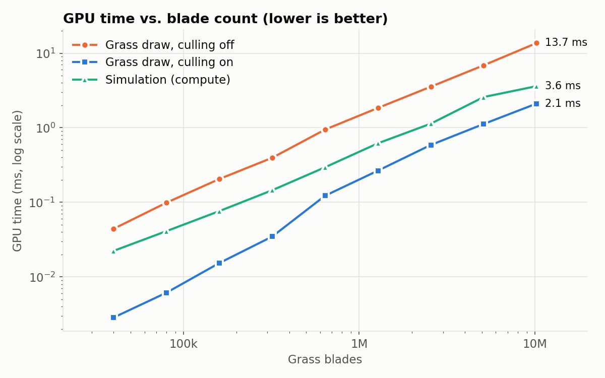
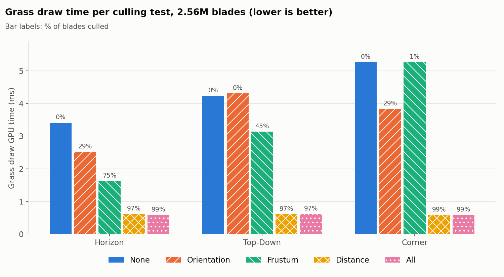
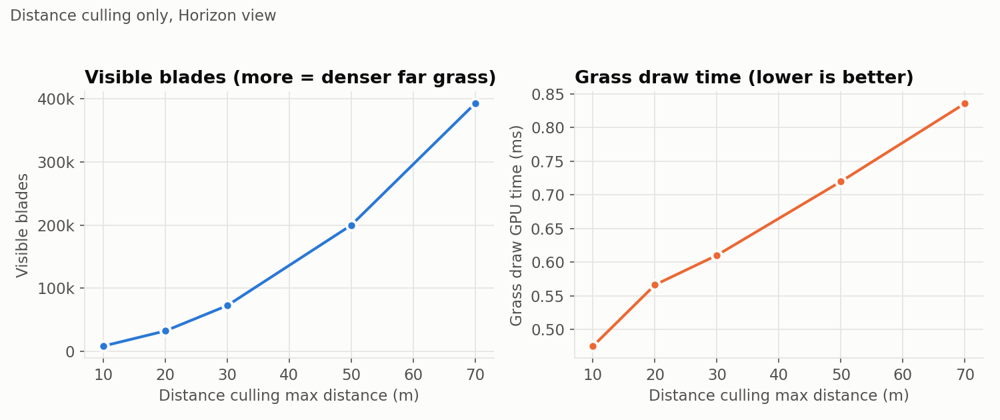

Vulkan Grass Rendering
==================================

**University of Pennsylvania, CIS 5650: GPU Programming and Architecture, Project 5**

* Logan Dooley
  * [LinkedIn](https://www.linkedin.com/in/logan-dooley-a205a619a/)
* Tested on: Windows 11, AMD Ryzen 7 9800X3D, 32GB RAM, NVIDIA GeForce RTX 5060 Ti 16GB

## Overview
Real-time grass using Vulkan compute and mesh shaders. Based on the paper, [Responsive Real-Time Grass Rendering for General 3D Scenes](https://www.cg.tuwien.ac.at/research/publications/2017/JAHRMANN-2017-RRTG/JAHRMANN-2017-RRTG-draft.pdf).
Compute shaders are used for blade placement and simulation, while task and mesh shaders are used for culling and blade mesh generation.

### Deviations from the base project
- Written from scratch on Vulkan 1.4 
  - Vulkan-Hpp RAII
  - Dynamic rendering
  - Synchronization2
  - Buffer device addresses instead of descriptor sets
- Mesh shaders instead of tessellation 
  - Task shader culls blades and compacts the
  survivors
  - Mesh shader builds each blade's geometry
- Slang shaders compiled by CMake
- CMakeList rewritten

## Features
- Bezier grass blades with GPU-side placement w/ stratified random sampling
- Physics: gravity, recovery, wind, state validation
- Culling: orientation, frustum, distance
- Mesh-shader blade geometry
- ImGui panel: live culling/physics/density controls, GPU timestamp profiler [Extra Credit]
- Benchmark mode
- Visible blade readback/counter

## Pipeline
All blade data lives in one GPU-only buffer which is 64 bytes per blade: 
- `v0`, 
- `v1`, 
- `v2`, 
- `up`

Orientation, Height, Width and Stiffness packed into the `w` components of these members. 
This project does not use descriptor sets, so shaders can access this data through buffer device addresses passed through push constants.

**Once at startup (also when density or radius changes):**
- **Init (compute shader):** One thread per grass blade. Responsible for:
  - Placing the blade using stratified sampling
  - Picking a random orientation, height, width and stiffness

**Every frame:**
- **Simulation (compute shader):** One thread per grass blade. Responsible for:
  - Applying gravity, recovery and wind to `v2`.
  - Validating `v2` state and recomputing `v1`.

- **Culling (task shader):** One workgroup per 32 blades. Responsible for:
  - Orientation, Frustum and Distance culling.
  - The survivors are placed into the task shader's payload with a workgroup-shared counter.
  - The group launches one mesh workgroup per visible blade.

- **Blade geometry (mesh shader):** One workgroup w/ 16 threads per visible grass blade. Responsible for:
  - Each thread evaluates one vertex on the bezier curve.
  - 16 vertices are written
  - 14 triangle are written

- **Shading (fragment shader):** Responsible for:
  - A simple root-to-tip color gradient with two-sided diffuse lighting based on a hard-coded light direction.

## Progress
### 1. Static blades
### 2. Gravity + recovery
### 3. Wind
### 4. Orientation culling
### 5. Frustum culling
### 6. Distance culling

## Implementation notes
Using v-sync with a 240 Hz monitor causes frame rates to oscillate back and forth because frames are presented in pairs. The CPU waits for one image, and the next image is already free so the time waiting on the next swapchain image alternates between virtually instantaneous and having some wait time. As a workaround, I added an exponential moving average smoothed version of delta time to pass into the simulation shader so the simulation would be smoother.

## Performance Analysis

### Method
There is a built-in benchmark mode that you can run (`vulkan_grass_rendering.exe --benchmark`) that goes
through a fixed list of camera views and settings configurations and writes one CSV row per configuration as an output. The settings it uses/tests are:

- Release build, validation layers off, vsync off, 1280×720 window
- Grass field: 200×200 m (radius 100 m). Blade count is controlled by the density (blades/m²)
- GPU times come from Vulkan timestamp queries placed around the simulation compute pass and the grass
  draw pipeline. Each configuration uses 120 frames for warmup, then averages actual results over 300 frames.
- The visible blade count comes from a GPU counter. Each workgroup adds its surviving blades with one atomic add, and the total is copied back to the CPU.

The camera views I used for the measurements are:

| View | Position | Yaw / Pitch | Description |
|---|---|---|---|
| Horizon | (0, 1.7, 0) | 0° / 0° | Standing in the middle of the field, looking out |
| Top-Down | (0, 100, 0) | 0° / −85° | Looking almost straight down from above |
| Corner | (100, 1.7, 100) | −45° / −5° | At a corner, looking diagonally across the field |

### Blade count


*Horizon view: all culling tests enabled with a 30 m max blade distance.*

#### Analysis
The first observation is that the runtime scales linearly with the number of blades. This makes sense since drawing an additional blade doesn't depend on others around it very much, so the rendering is linear with the blade count.

Another observation is that drawing is demonstrably more costly than simulation. With culling disabled, the grass drawing is roughly 2-4 times more expensive than the simulation step is. This could be because the simulation is only one thread per blade, whereas the draw is 14 triangles per blade so runs a lot more computation.

### Culling Tests


*2.56M blades w/ distance culling max distance of 30 m.*

| View | None | Orientation | Frustum | Distance | All |
|---|---|---|---|---|---|
| Horizon | 3.41 ms | 2.52 ms (29%) | 1.62 ms (75%) | 0.61 ms (97%) | 0.58 ms (99%) |
| Top-Down | 4.23 ms | 4.31 ms (0%) | 3.14 ms (45%) | 0.61 ms (97%) | 0.61 ms (97%) |
| Corner | 5.26 ms | 3.84 ms (29%) | 5.26 ms (1%) | 0.58 ms (99%) | 0.59 ms (99%) |

*Grass draw GPU time. Percentages are the % of blades culled.*

#### Analysis
The camera view has a significant impact on which culling tests provide the most benefit.

- **Orientation:** Since this culls blades seen nearly edge-on, it has the biggest impact for cameras looking roughly horizontally to the blades themselves. As a result, the Horizon and Corner tests measure 29% of blades are culled by orientation culling, whereas Top-Down doesn't cull any blades at all.

- **Frustum:** Since this depends on how much of the field is in view, it has the biggest impact for cameras that have some aspect pointing away from placed grass. As a result, the Horizon camera view has the highest culled percentage of 75% since it is roughly in the middle of the field with a view angle of around 88 degrees, which is about 25% of 360. On the other hand, from the Corner camera view, the entire field is in view pretty much, so only 1% is culled.

- **Distance:** Since this depends on how close grass is to the camera, it is roughly independent of the camera view in these tests. This is because using a 30 m radius, only a small part of the field is covered anyways, so the amount culled is pretty high, at 97% for Horizon and Top-Down, and 99% for Corner.

One note on culling is that it has a fixed cost regardless of how many blades are culled. From the tests, it shows that the draw takes about 0.58 ms even in cases with 99% of the blades that are culled. This is due to the task shader doing the culling testing on all the blades. 

Additionally, in the Top-Down test, orientation culling culls virtually nothing, but the frame time goes up from 4.23 ms with no culling to 4.31 ms with culling. Therefore culling isn't always a benefit if it doesn't actually cull any blades out. 

### Distance Culling Max Distance


#### Analysis
The first observation is that the number of visible blades grows in a squared relationship with the max culling distance. This is because the surviving area is a circle of the given radius, which has an r² relationship.

The second observation is that the draw time does not grow as quickly as visible blades do. It is more of a linear increase. This is likely because there is just a fixed cost of testing all the blades. Around 0.45 ms will always happen, and then a little extra for drawing each visible blade.

## Build

### Requirements
- Windows with Visual Studio 2022 (C++ desktop workload) (this is the setup I tested with)
- CMake ≥ 3.25
- [Vulkan SDK](https://vulkan.lunarg.com/sdk/home) 1.4. It contains `slangc`, Vulkan-Hpp and VMA.
  The installer should set the `VULKAN_SDK` environment variable, which CMake needs to find `slangc`.
- A GPU/driver that supports Vulkan 1.4 and the `VK_EXT_mesh_shader` extension

### Building
GLFW, GLM, stb and Dear ImGui are added as git submodules, so you should clone the project recursively:
```
git clone --recursive https://github.com/LoganDooley/Project5-Vulkan-Grass-Rendering.git
```
If you already have a clone and need to update the submodules, then you can run:
```
git submodule update --init --recursive
```
Then configure and build:
```
cmake -S . -B build -G "Visual Studio 17 2022" -A x64
cmake --build build --config Release
```
Shaders are compiled from the `src/shaders/*.slang` folder to SPIR-V as part of the build and are placed next to
the executable in `build/bin/<Config>/shaders/`.

### Running
You should run the executable from its own folder, because shaders are loaded relative to the working directory. You can do that by running:
```
cd build/bin/Release
./vulkan_grass_rendering.exe
```
Debug builds will enabled vulkan validation layers, but release builds won't

| Control | Action |
|:--|---|
| W / A / S / D | Move |
| Space / Left Shift | Move up / down |
| Hold right mouse button | Look around |
| Esc | Quit |

Other settings are accessible from the ImGui panel that will display

### Benchmark
This was a tool primarily for myself, but you can run the project in benchmark mode via:
```
./vulkan_grass_rendering.exe --benchmark
```
This runs every configuration from the Performance Analysis without any input, writes
`benchmark_results.csv` to the working directory, and then closes the application automatically.

### CMake changes
The base project's CMake setup was replaced completely. I added a single `CMakeLists.txt` at the root and also a `cmake/SlangShaders.cmake` file which compiles each `.slang` file to SPIR-V using `slangc`.

## Credits
- Jahrmann & Wimmer, "Responsive Real-Time Grass Rendering for General 3D Scenes" (2017)
- [GLFW](https://github.com/glfw/glfw)
- [GLM](https://github.com/g-truc/glm)
- [Dear ImGui](https://github.com/ocornut/imgui)
- [Vulkan SDK](https://vulkan.lunarg.com/sdk/home)
- [VMA (Through the Vulkan SDK)](https://github.com/GPUOpen-LibrariesAndSDKs/VulkanMemoryAllocator)
- PCG hash: Nathan Reed ["Hash Functions for GPU Rendering"](https://www.reedbeta.com/blog/hash-functions-for-gpu-rendering/)
